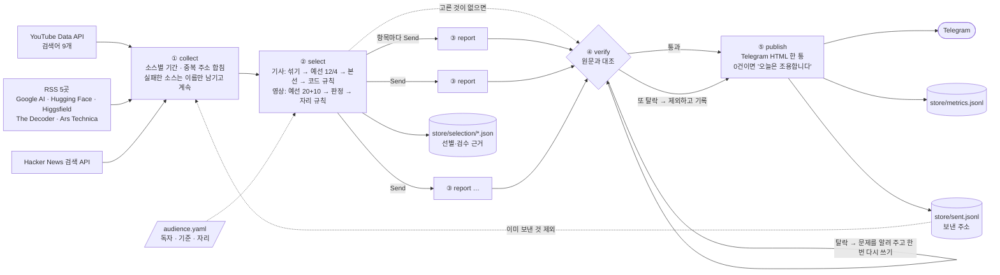
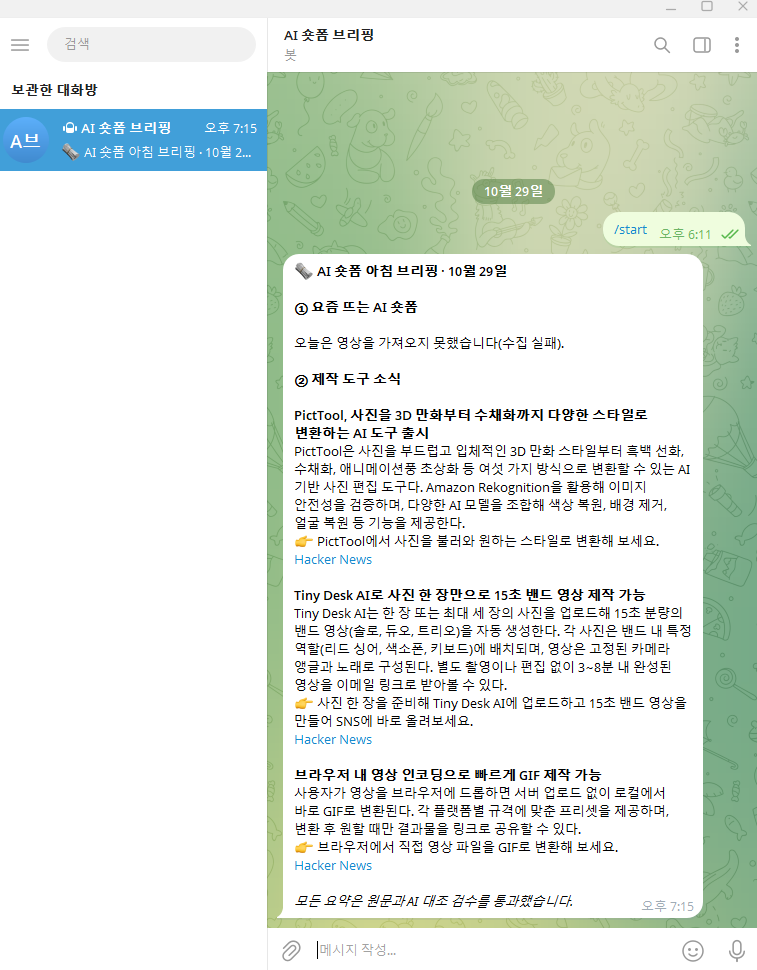

# REPORT · AI 숏폼 아침 브리핑

## 1. 분야와 독자

**분야**: AI로 만든 숏폼 영상과, 그런 영상을 만드는 도구.

**독자**: AI 숏폼을 막 시작했거나 꾸준히 올리는 한국의 개인 창작자. 무료이거나 저렴한 도구를 반기고, 요즘 어떤 형식이 뜨는지와 바로 써 볼 만한 도구 소식을 아침에 먼저 보고 싶어 한다.

처음 목표는 "인스타그램에서 요즘 뜨는 AI 릴스 보기"였다. 인스타그램은 자동 수집을 막아 두었고, 공식 해시태그 API는 비즈니스 계정·페이스북 페이지·앱 심사가 필요하다. 그래서 목표는 그대로 두고 공식적으로 열린 통로(YouTube Data API, RSS, 검색 API)로 바꿨다. 기사만 모으면 처음 목표가 빠지기 때문에 브리핑을 두 칸으로 나눴다.

| 칸 | 내용 | 하루 |
|---|---|---|
| ① 요즘 뜨는 AI 숏폼 | AI로 만든 작품·밈, AI 도구 사용법·제작기 영상 | 2편 |
| ② 제작 도구 소식 | 새 도구·모델, 가격·무료 한도 변화, 제작 기법, 저작권·플랫폼 정책 | 3건 |

독자 기준은 코드가 아니라 [`audience.yaml`](audience.yaml)에 둔다. 선별·요약 노드가 이 파일을 읽어 LLM 지시문을 만든다.

- **버림**: 비교·순위 홍보 글, 연구·벤치마크 수치
- **우선순위만 낮춤**: 투자 소식, 영상과 무관한 AI 소식

## 2. 소스 채택표

후보 17곳을 [`measure_sources.py`](measure_sources.py)로 쟀다. 원자료는 [`measurements/`](measurements/)에 있다.

- **기사 소스 측정 항목**:
  - 최근 7일 글 수
  - 가장 최근 글이 몇 시간 전인지
  - 표본 3건 중 본문이 600자 이상 추출되는 수
  - robots.txt 허용 여부
  - 제목·요약에 영상·이미지 생성 낱말이 나오는 비율(관련도)
- **영상 소스 측정 항목**: 본문 대신 설명 글자 수, 조회수 중앙값

### 채택

| 소스 | 방식 | 7일 | 최신 | 본문 | 관련도 | 채택 이유 · 조건 |
|---|---|---|---|---|---|---|
| YouTube AI 영상(한국) | Data API | 50/50 | - | 설명 34/50 | 조회 중앙값 2.3만 | 처음 목표에 가장 가까운 통로. 7일, 제목에 한글 있는 영상만, 안전 검색, 이미 보낸 영상 제외 |
| Google AI 블로그 | RSS | 1 | 62h | 3/3 | 0.25 | 공식 발표처. 글이 뜸해 수집 기간 72시간 |
| Hugging Face 블로그 | RSS | 6 | 15h | 3/3 | 0.12 | 공개 모델 소식. 바로 써 볼 수 있는 것이 많음. 72시간 |
| Higgsfield 블로그 | RSS | 20 | 15h | 3/3 | **0.46** | 기사 소스 중 관련도 최고. 홍보 글이 섞여 **하루 1건 상한** |
| The Decoder | RSS | 10 | 11h | 3/3 | 0.20 | 영상·이미지 모델 소식이 빠름. 최근 10건만 제공 |
| Ars Technica AI | RSS | 13 | 11h | 3/3 | 0.10 | 해설이 깊고 본문이 안정적 |
| Hacker News 검색 API | 공식 API | 49 | 13h | 1/3 | **0.80** | 새로 나온 작은 도구를 잡음. 72시간, 추천 3점 이상. 본문 없는 글은 다음 순위로 대체 |

### 탈락

| 소스 | 탈락 이유 |
|---|---|
| OpenAI 뉴스 | 본문 추출 0/3(403) |
| NVIDIA 블로그 | 관련도 0.06. 데이터센터·하드웨어 소식 위주 |
| Stability AI 뉴스 | 피드 주소가 빈 문서 |
| VentureBeat AI | 429 요청 한도·차단 |
| 블로터, 디지털투데이 | 관련도 0.08 / 0.0. 시간대 없는 날짜 표기로 시각도 9시간 어긋남 |
| Reddit r/aivideo | robots.txt가 수집 금지 |
| arXiv cs.CV | 피드 항목 0, 독자에게 어려운 논문 |
| YouTube AI video(세계) | 상위가 한국 독자와 먼 해외 코미디 영상 |
| Civitai 인기 영상 | 독자층(이미지 모델 사용자)이 다르고 조회수와 단위가 달라 함께 줄 세울 수 없음 |
| Higgsfield 프리셋 페이지, Kling 앱 | 피드도 목록 API도 없음. 페이지 HTML에 영상 정보가 없고 문서화되지 않은 내부 주소에서 불러옴 → 스크래핑이라 제외 |

### 유튜브 검색어

후보 17개를 [`measure_queries.py`](measure_queries.py)로 쟀다. 원자료는 [`measurements/queries-20261029-1627.json`](measurements/queries-20261029-1627.json)이다.

| 무리 | 채택한 검색어 | 무엇을 잡는가 |
|---|---|---|
| 장르 | AI 영상, AI 드라마, AI 쇼츠, AI 밈 | 조회수가 오른 작품·밈 (AI 드라마 조회 중앙값 50만) |
| 도구 | 힉스필드, 런웨이 AI, 나노바나나, 클링 AI, seedance | 사용법·제작기 (조회수 수백~수천) |

| 뺀 검색어 | 이유 |
|---|---|
| 시댄스 | 22건 전부 세종시 댄스학원 |
| 소라 AI | 가수 이름 "소라"가 잡힘 |
| 제미나이 영상 | 정치 뉴스(AI를 다룰 뿐 AI로 만든 영상이 아님) |
| 비오3, 하이루오 | 결과 0건 |

## 3. 선별 로직

선별은 LLM이 정하는 부분과 코드가 막는 부분을 나눴다.

- **LLM**: 독자 기준에 따른 상대 평가를 맡는다.
- **코드**: 중복, 상한, 본문 길이를 막는다.

프롬프트로 "같은 사건은 하나만"이라고 부탁해도 지켜지지 않는 경우가 있었기 때문이다. 실행마다 예선 통과·탈락 제목, 본선 제외 사유, 영상 라벨과 이유가 [`store/selection/`](store/selection/)에 남는다.

### 기사 칸: 예선 → 본선

1. **섞기**: 소스를 번갈아 섞은 뒤 묶는다. 수집 순서대로 자르면 한 묶음이 Hacker News 3~5점 글로만 채워져 약한 글이 그대로 통과했다.
2. **예선**: 12건씩 묶어 묶음마다 4건을 고른다. 묶음끼리는 서로를 모른다.
3. **본선**: 예선 통과 글(12건 안팎)을 한 번에 보고 순위를 매긴다. 목표 3건보다 5건 많은 8건까지 받는다. 이 여유분은 본문이 없는 글을 대신 채우는 데 쓴다. 순위마다 이유와 "사건 이름"을 함께 적게 한다.
4. **코드 규칙**: 순위를 위에서부터 내려가며 다음 경우는 건너뛴다.
   - 앞에서 이미 고른 사건과 같은 사건
   - 하루 상한을 넘은 소스 (Higgsfield 1건, 나머지 2건)
   - 본문이 600자 미만인 글

   빈자리는 다음 순위로 채운다.

**실제 기록**: 2026-10-29 19:15 실행, [`store/selection/20261029-1915.json`](store/selection/20261029-1915.json)

| 묶음 | 예선 통과 (4) | 탈락 예 |
|---|---|---|
| 1 (12건) | Tiny Desk AI, NVIDIA Nemotron 3.5(Hugging Face), LFM3, Android 개발 개방 | Gemini 4 Carbon, "Higgsfield AI vs OpenArt"(비교 홍보) |
| 2 (12건) | Oracle 이미지·영상 모델, Nemotron 3.5(The Decoder), OpenAI Dots, Claude for Legal | "5 Best Platforms to Access Kling 4.0"(순위 홍보) |
| 3 (10건) | PictTool 이미지 도구, Gifup GIF 도구, MAI Image 2.7, 창업 칼럼 | "6 Best AI Video Tools"(순위 홍보) |

- **본선 결과**: PictTool, Tiny Desk AI, Gifup.
- **고른 이유 예**: "브라우저에서 바로 GIF를 만들 수 있어 숏폼 제작에 도움".
- **본선 제외**: 같은 Nemotron 소식 두 건과 Oracle·LFM3 등은 "본선 순위 밖"이었다. 연구·업무용 소식(Claude for Legal, MAI Image 벤치마크)은 "본선 탈락"이었다.

이 실행은 3건이 모두 Hacker News에서 나왔다. 그래서 상한이 없던 소스에도 **하루 2건 상한**을 두었다.

### 영상 칸: 코드 예선 → LLM 판정 → 자리 규칙

1. **예선(코드)**: 조회수 상위 20편과, 도구 검색어로 찾은 영상 중 조회수 상위 10편을 뽑는다. 사용법·제작기는 조회수가 수백~수천이라 조회수로만 자르면 본선에 오르지 못했다.
2. **판정(LLM)**: 영상마다 두 칸을 따로 정한다.
   - AI로 만들었는가: AI로 만듦 / AI를 다룸 / AI 무관
   - 갈래: 작품 / 밈 / 정보 전달 / 뉴스·해설 / 기타

   이유 칸을 라벨보다 앞에 두었다. 처음에는 라벨 하나에 두 질문을 섞고 이유를 뒤에 두었는데, 라벨과 이유가 거꾸로 나왔다.
3. **코드 규칙**:
   - 작품·정보 전달로 판정됐더라도 유머·패러디 낱말이 있으면 밈으로 바꾼다.
   - 도구 이름과 사용법·가격·출시 낱말이 함께 있으면 정보 전달로 바꾼다.
   - 바뀐 영상은 근거 파일에 `meme_rule`, `info_rule`로 표시된다.
4. **남기기**: 작품·밈은 "AI로 만듦"만 남긴다. 정보 전달은 "AI를 다룸"도 남긴다.
5. **자리**: 첫 자리는 작품·밈, 둘째 자리는 도구 검색어로 찾은 정보 전달 영상이다. 같은 채널은 하루 1편만 싣는다.

**실제 기록**: [`store/selection/20261029-1719.json`](store/selection/20261029-1719.json)

| 상황 | 결과 |
|---|---|
| 조회수 상위 30편 | 「훈작가의 숏드라마」 영상이 5편 → 채널 규칙으로 1편만 남음 |
| 판정 이유 | 시니어 드라마는 제목·설명의 `#AI가상인물`, 힉스필드 영상은 설명 속 도구 이름을 근거로 적음 |
| 문제 발견 | 둘째 자리를 전투기 자동 충돌 회피 장치 해설 영상(98만)이 차지 → 둘째 자리를 "도구 검색어로 찾은 영상"으로 제한 |
| 고친 뒤 17:25 실행 | 첫 자리 시니어 드라마(작품) + 둘째 자리 힉스필드 VFX 제작기(정보 전달, 조회 4,129) |

그때는 영상 칸의 최종 선택을 근거 파일에 남기지 않아서 17:25 결과는 실행 로그로만 확인했다. 기사 칸처럼 영상 칸도 최종 선택과 이유를 `trend.chosen`에 남기도록 고쳤다.

## 4. 파이프라인 구조도

- **③ report**: 항목마다 `Send`로 펼쳐 동시에 요약한다. 결과는 리듀서(`operator.add`)로 모인다.
- **세 칸**:
  - `headline`, `summary`는 근거(기사 본문 또는 영상 제목·설명)에 있는 내용만 쓴다.
  - 독자 정보는 `why`에만 넣는다. 독자 정보를 세 칸 모두에 주었더니 헤드라인에 "AI 숏폼 창작 지원"처럼 원문에 없는 연결이 생겼다.
  - `why`는 "오늘 해 볼 행동 하나"다. 행동할 거리가 없으면 "지켜볼 점:"으로 쓴다.
- **한국어 확인**: 한글 글자가 60% 미만이면 한 번 다시 쓰고, 그래도 아니면 뺀다.
- **④ verify**: 요약과 별개의 LLM 호출(LLM-as-a-Judge)이다.
  - 검사 범위는 헤드라인·요약과, `why` 안의 사실 주장(무료·가격·기능·숫자)이다.
  - 판정 칸은 문제 목록을 먼저, 통과 여부를 뒤에 둔다.
- **⑤ publish**:
  - 기본은 미리보기만 남긴다. `--send`일 때만 보낸다.
  - 응답이 애매하면 중복 발송을 피하려고 다시 보내지 않는다.
  - 영상 칸이 비면 "수집 실패" 또는 "조건에 맞는 영상이 없습니다"라고 그 칸에 적는다.

## 5. 실행 기록

### 정상 발행 화면

2026-10-29 19:15에 보낸 첫 브리핑이다.

### 실행 기록 (`store/metrics.jsonl`)

| 시각 | 수집 | 선별 | 요약 | 검수 통과 | 첫 판정 탈락 | 재작성 후 통과 | 발행 소스 | 상태 |
|---|---|---|---|---|---|---|---|---|
| 10-29 18:13 | 34 | 3 | 3 | 3 | 1 | 1 | Hugging Face 2, Higgsfield 1 | dry-run |
| 10-29 19:15 | 34 | 3 | 3 | 3 | 0 | 0 | Hacker News 3 | Telegram 1통 보냄 |
| 10-29 23:16 | 37 | 3 | 2 | 2 | 2 | 2 | Hugging Face 1, Hacker News 1 | Telegram 1통 보냄 (GitHub Actions) |

18:13과 19:15는 저장된 수집 결과(17:38 수집)를 다시 썼다. 그 수집에서 YouTube가 `HTTPError 429`로 실패했기 때문에 영상 칸은 "오늘은 영상을 가져오지 못했습니다(수집 실패)."로 나갔다.

23:16은 GitHub Actions에서 처음 돌린 실행이다([실행 화면](https://github.com/songyee-ai/ai-shortform-brief/actions/runs/40889501795), 수동 실행). 새로 수집했고, 19:15에 보낸 3건은 발행 기록과 대조해 뺐다. 선별한 3건 중 Hugging Face 1건은 요약이 영어로 나와 제외했고 2건이 나갔다. 실행이 끝나자 `github-actions[bot]`이 이 파일과 선별 근거를 저장소에 커밋했다. 이후로는 매일 07:30 예약 실행이 이 파일에 한 줄씩 더한다.

### 검수가 잡은 실제 환각

| 실행 | 항목 | 검수가 찾은 문제 | 처리 |
|---|---|---|---|
| 17:35 | PictTool | 인사이트의 "무료 체험" — 근거에 없음 | 다시 썼지만 영어로 나와 제외 → 다시 쓸 때 "반드시 한국어" 지시 추가 |
| 17:38 | PictTool | 같은 "무료 체험" | 한국어로 다시 써서 통과 |
| 18:13 | LFM3 | "무료로 사용해 보고" — 근거에 없음 | 다시 써서 통과 |
| 23:16 | NVIDIA Nemotron 3.5 Transcribe | "무료" — 근거에는 공개(오픈 가중치)만 있음 | 다시 써서 통과 |
| 23:16 | AI UGC 광고 영상 도구 | "무료 체험" — 근거에 없음 | 다시 써서 통과 |

독자가 무료 도구를 반긴다는 정보를 주자, 행동 제안이 원문에 없는 "무료"를 지어냈다. 그래서 검수 범위를 `why` 안의 사실 주장까지 넓혔다. 23:16 실행에서도 같은 유형이 두 번 나왔고, 둘 다 검수가 잡았다. "공개"를 "무료"로 바꿔 말하는 것이 가장 자주 나온 환각이다.

### 일부러 틀린 요약 시험

[`check_verify.py`](check_verify.py)는 정답을 아는 가상의 예문에 맞는 요약 2개와 틀린 요약 4개를 넣는다. 결과는 **6/6 기대대로**였다. 원자료는 [`store/verify-test-20261029-1734.json`](store/verify-test-20261029-1734.json)에 있다.

| 경우 | 기대 | 결과 |
|---|---|---|
| 맞는 요약 | 통과 | 통과 |
| 표현만 바꿈(월 → 한 달에) | 통과 | 통과 |
| 숫자 틀림(10초 → 60초) | 탈락 | 탈락 |
| 없는 무료 주장(인사이트) | 탈락 | 탈락 |
| 없는 기능(4K) | 탈락 | 탈락 |
| 사용자 수 부풀림(30만 → 300만) | 탈락 | 탈락 |

## 6. 회고

### 잘 된 것

- **조용한 실패를 찾아 막았다**:
  - 수집 단계가 영상 설명을 `summary`에 담았는데, 요약 단계가 같은 이름으로 덮어썼다. 그래서 검수가 원문 대신 모델이 쓴 요약 자신과 대조하고 있었다. 영상 요약이 늘 통과하는 버그였고, 가짜 시험에서 찾아 원문 칸을 `excerpt`로 나눴다.
  - 영상 칸이 비면 메시지에서 말없이 사라졌다. 이제는 이유를 그 칸에 적는다.
  - 전송이 실패해도 정상 종료하던 것을 실패 코드로 끝내게 해서, 예약 실행에서도 실패가 드러난다.
- **"프롬프트는 요청일 뿐"을 코드로 받쳤다**: 밈 정의를 고쳐도 모델이 따르지 않았고, 같은 영상의 판정도 실행마다 흔들렸다. 지시문을 계속 고치는 대신 다음은 코드가 정하게 했다.
  - 같은 사건, 소스 상한, 같은 채널
  - 밈·정보 전달 낱말 규칙
  - 자리마다 고를 수 있는 영상
- **모르는 것을 판단하게 하지 않았다**: 모델이 "나노바나나", "구글 플로우"를 AI 도구 이름으로 알아보지 못해 사용법 영상 8편을 "AI 무관"으로 판정했다. 도구 이름 목록을 지시문에 넣은 뒤로는 10편 중 9편을 바르게 판정했다.
- **숫자로 고르고 숫자로 뺐다**: 소스와 검색어를 감으로 정하지 않고 측정한 뒤 정했다. 측정이 "시댄스 = 댄스학원"처럼 이름만 보고는 모를 함정을 보여 주었다.

### 한계

- **YouTube 429**: 한 번씩 요청하면 정상인데, 검색 9개를 연달아 보내면 429가 났다. 재시도(3초·10초)와 검색 사이 1초 간격을 넣었지만 원인은 확정하지 못했다. 그래서 정상 발행 화면에 영상 칸이 비어 있다. 23:16 GitHub Actions 실행에서도 똑같이 429가 났으니 이 PC의 네트워크 문제는 아니고, 키나 요청 방식 쪽을 더 봐야 한다.
- **요약이 영어로 나올 때가 있다**: 한국어가 아니면 "반드시 한국어"로 한 번 더 요청하고, 그래도 영어면 뺀다. 23:16 실행에서 영어 원문 1건이 두 번 모두 영어로 나와 제외됐고, 그날은 2건만 나갔다.
- **LLM 선별이 실행마다 다르다**: temperature 0, 같은 입력에서도 고른 기사가 달라졌다(18:13 Hugging Face 2건 → 19:15 Hacker News 3건). 소스 상한으로 쏠림은 막았지만 순위 자체의 흔들림은 남는다.
- **영상은 보지 않고 요약한다**: 제목·설명만 근거로 쓰고, 메시지에 그렇게 밝힌다.
- **놓칠 수 있는 소식**: The Decoder는 최근 10건만 주기 때문에, 하루 한 번 수집하면 일부를 놓칠 수 있다.
- **3건이 안 될 수 있다**: 본선 후보가 거의 한 소스뿐인 날은 상한 때문에 2건만 나갈 수 있다.
- **말투**: 요약이 "~했다"로 끝나는 경우가 많다.

### 다음에 바꿀 것

- 인스타그램 공식 해시태그 API(`top_media`)를 연결해 처음 목표였던 릴스를 직접 받는다.
- 유튜브 검색을 줄이고(검색어 묶기), 요청 간격을 실측해 429를 없앤다.
- 본선 순위를 두 번 매겨 겹치는 것만 고르는 식으로 선별의 흔들림을 줄인다.
- `metrics.jsonl`이 쌓이면 소스별 발행 비율과 검수 탈락률을 보고 소스를 다시 고른다.
